# ASTRA-MED: final QA report

Date: 2026-11-14. Scope: full-product quality and scientific-integrity pass on
the redesigned console. No redesign was made.

## 1. Automated checks

| Check | Command | Result |
| --- | --- | --- |
| TypeScript (strict) | `npm run typecheck` | Pass, 0 errors |
| ESLint | `npm run lint` | Pass, 0 errors, 0 warnings |
| Unit tests | `npm run test` | **67 passed** across 5 files |
| Production build | `npm run build` | Pass. Main chunk 464 kB (130 kB gzip); chart chunk 436 kB (122 kB gzip), lazy-loaded |
| Live DONKI per endpoint | `npm run donki:check` | CCMC DONKI API: HTTP 200 for FLR, SEP, CME and notifications, with all timestamps parseable. api.nasa.gov: HTTP 429 (DEMO_KEY exhausted). Output in `docs/qa-donki-check.txt` |
| Screenshots | `npm run qa:screenshots` | 16 views captured from the production build (section 5) |

Unit test coverage by file:

- `missionTelemetry.test.ts`: 180 days, determinism, cumulative dose equals the running sum and never decreases, plausible bounds, scenario B and C overlays.
- `engine.test.ts`:
  - every threshold boundary, persistence (sleep 2 days, mood 3 days), stale and missing data, aggregation, and propagation to body systems
  - radiation rebasing, XP awarded once, streaks, readiness bounds, follow-ups
  - scenario C hazard levels for days 130–134, its system relationships, protective actions with a basis, and that a hazard never changes health status
  - every diagnostic carries a basis
- `nasaDonkiApi.test.ts`:
  - per type: success parsed to ISO timestamps, CCMC-to-api.nasa.gov fallback with HTTP status recorded, both hosts failing, empty list, non-list JSON, malformed JSON, timeout
  - partial failure across types
  - the documented URL format, with no trailing slash and the key on api.nasa.gov only
  - cache v1-to-v2 migration and re-labelling as cached
  - label rules for LIVE, PARTIAL, CACHED, ARCHIVED and UNAVAILABLE
- `missionStore.test.ts`: validation (range, BP order, ship time, dose cannot decrease), persistence across store instances, history never overwritten, corrupt storage recovery, storage unavailable, reset.
- `dates.test.ts`: day boundaries line up with MET, every synthetic timestamp falls on its own day, top-bar MET equals day minus one, stamps and ship-time parsing.

## 2. Browser verification (built-in browser, dev server)

| Area | What was checked | Result |
| --- | --- | --- |
| DONKI migration | Refresh made 4 requests to `ccmc.gsfc.nasa.gov/DONKI-API/get/{FLR,SEP,CME,notifications}`, all HTTP 200. The feed table showed each type LIVE from CCMC. | Pass |
| LIVE semantics | Before any request this session: CACHED with "No request yet this session". After refresh: LIVE. Offline: UNAVAILABLE, showing cached data, with every row CACHED. Back online: LIVE. Reload: CACHED. | Pass |
| Cache migration | An old v1 cache was read back as CACHED for all four types | Pass |
| Scenario C | Day 131: hazard WARNING "Onset and peak". Envelope on the astronaut and affected systems listed. Immune and radiation: CAUTION from the dosimeter overlay rule, with the hazard marked "not personal dose". Four protective actions, each with a basis and a Mark done button. | Pass |
| Mission time | Day 131 shows MET `130/hh:mm:ss`. A dosimeter entry on day 131 at 21:15 ship time stored `recordedAt` 2026-09-11T21:15Z (epoch + 130 d) plus a separate `enteredAt`. The last-check stamp reads `D131 21:10` (crew readings; the automatic dosimeter is excluded). | Pass |
| Measurement logging | A dose lower than the previous day is rejected with a reason. A valid entry saves, recalculates status and charts, and links its task. | Pass |
| Trend annotations | Scenario events appear as dashed areas or lines with labels, plus a text list under the chart ("Simulated flare precursor (day 130); Simulated SEP event (day 131–133)") | Pass |
| Five systems | Each hotspot and label updates the system panel, diagnosis, trend tab, highlighted vitals and that system's countermeasures | Pass |
| Navigation | Console, Trends, Tasks, Alerts and Weather each land at the sticky offset (108 px) and move focus to the section heading. Sources opens the modal. Escape closes it and returns focus. | Pass, after a fix (section 3) |
| Deep links | `?scenario=sep&day=131`, `#system-…`, `#guide-…`, `#log-…`, `#sources-…`, `#trends` | Pass |
| Responsive | 1440, 820 and 390 px. No horizontal overflow at 375–390 px. Mobile order: status, astronaut, system panel, vitals, trend. | Pass, after two fixes |
| Persistence and corruption | Tested in the previous pass and unchanged: data survives reload, corrupt JSON is recovered with a notice, unavailable storage falls back to memory | Pass (store tests) |

## 3. Defects found and fixed in this pass

| # | Defect | Fix |
| --- | --- | --- |
| 1 | CCMC requests used the undocumented `/DONKI/WS/get` path | Moved to `/DONKI-API/get/` with no trailing slash. CCMC is tried first with DEMO_KEY. |
| 2 | One overall cache, so a partial failure could drop a type's data. Labels LIVE, PARTIAL, CACHED and DEMO only. | Per-type state and a per-type cache (v2). Five labels, including ARCHIVED and UNAVAILABLE, with per-type request results. |
| 3 | Manual entries stored the real wall-clock date while being assigned to a mission day, so MET was inconsistent | Ship-time entry on the mission timeline, a separate `enteredAt`, and one stamp format (`D042 06:41`) |
| 4 | Scenario C dose overlay was undocumented in the UI. The hazard was a single advisory with no system links. | Documented dose model; a phased WATCH, WARNING, WATCH, ALL CLEAR assessment; relationships to four systems; protective actions as follow-ups |
| 5 | Recommendations did not state their indicator, rule or basis | A `RecommendationBasis` on every diagnostic, follow-up, hazard action and the status-line action |
| 6 | No PVT or hydration trend | Added a "PVT & hydration" trend tab |
| 7 | Smooth scroll never finished in some browsers, so navigation did not move | Instant-scroll fallback after 700 ms |
| 8 | Hazard label clipped on mobile; status counts overflowed; rotated annotation label clipped | Right-aligned label, wrapping counts, unrotated label |
| 9 | "Last health check" was always the automatic 23:50 dosimeter reading | Excludes the dosimeter |

## 4. Consistency review

- **Five systems:** each system's status is the worst status of its metrics.
  - Neuro-ocular: sleep, PVT, symptoms.
  - Cardiovascular: heart rate, BP.
  - Musculoskeletal: ARED.
  - Immune and radiation: radiation.
  - Metabolic and circadian: glucose, temperature, mood, hydration, sleep.
  - Environmental hazards attach to systems through their stated relationships and never change status.
- **Eight indicators:** each has an evaluator, guidance, a basis, a vitals row and a trend tab. Five have a reference band (HR, BP, glucose, temperature, sleep). ARED has a plan line. Radiation has no band because limits are mission-dependent. Mood is plotted with sleep. The symptom check has no trend; it is a check, not a time series.
- **Rules:** every threshold in `src/config/thresholds.ts` carries a provenance tag. None is scientifically validated (see `DATA_SOURCES.md` §4).
- **Tasks:** seven tasks, each mapped to the systems it supports. PVT is scheduled every third day. XP is derived from records, so it can't be awarded twice.
- **Alerts:** show non-nominal indicators and active hazards (WATCH or WARNING). ALL CLEAR appears in the hazard panel and as post-event actions, not as an alert.
- **Status counts:** the status line counts 11 indicators (8 required plus 3 supplementary). Hovering it says so.

## 5. Screenshots

Captured from the production build with `scripts/qa-screenshots.mjs` (Chrome DevTools Protocol, fresh profile per run).

| # | View | File |
| --- | --- | --- |
| 1 | Console, scenario A, day 42 | 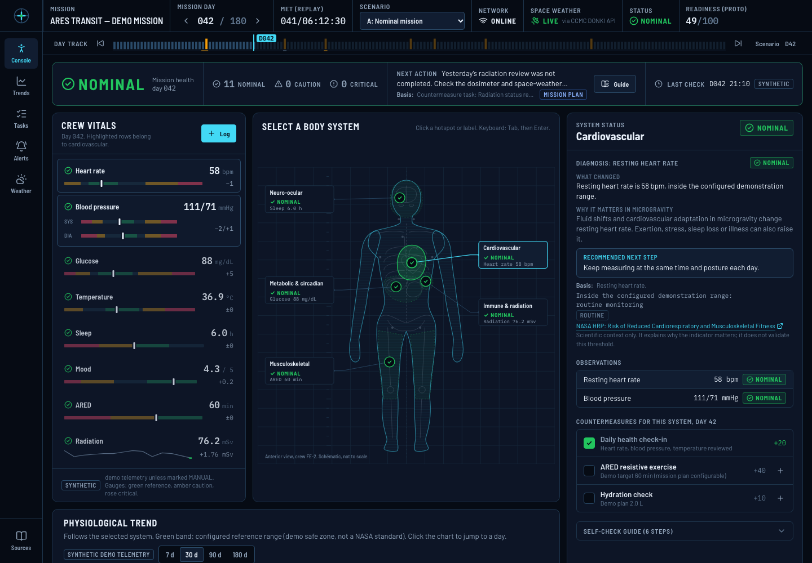 |
| 2 | Console, scenario B, day 118, cardiovascular | 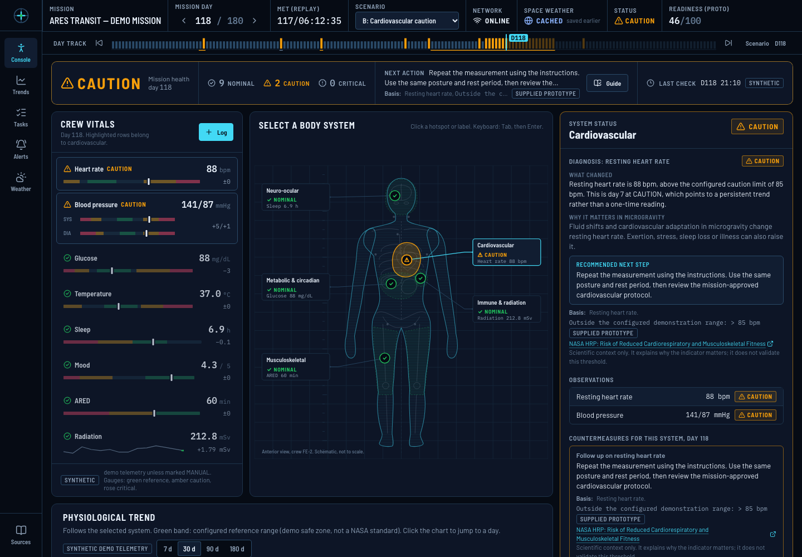 |
| 3 | Console, scenario C, day 131, immune and radiation | 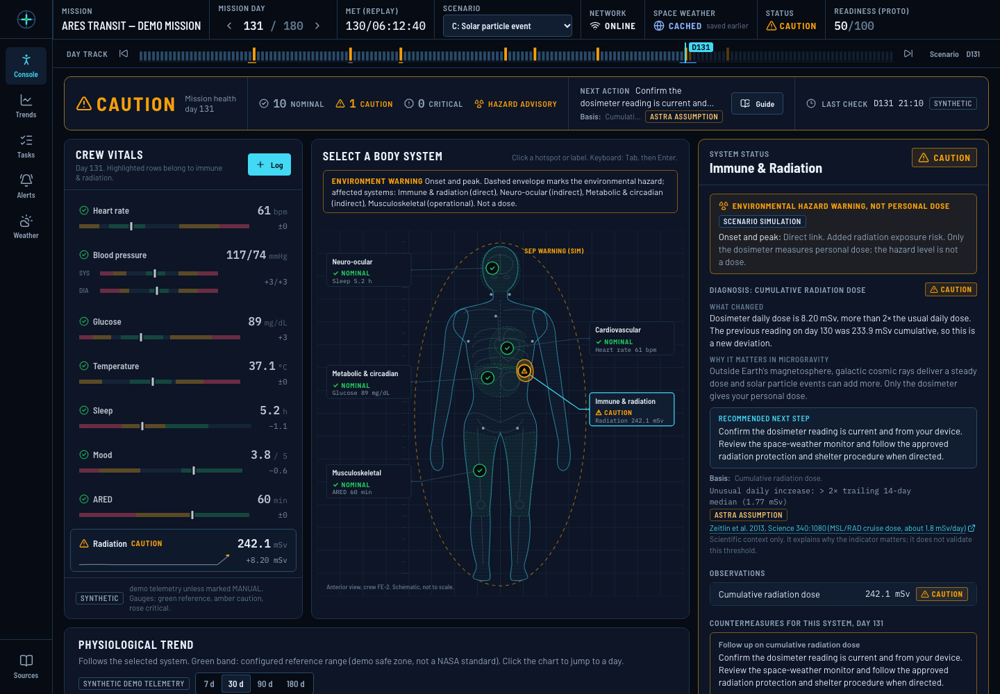 |
| 4 | Trend, heart rate, scenario B, with CAUTION period and drift annotation | 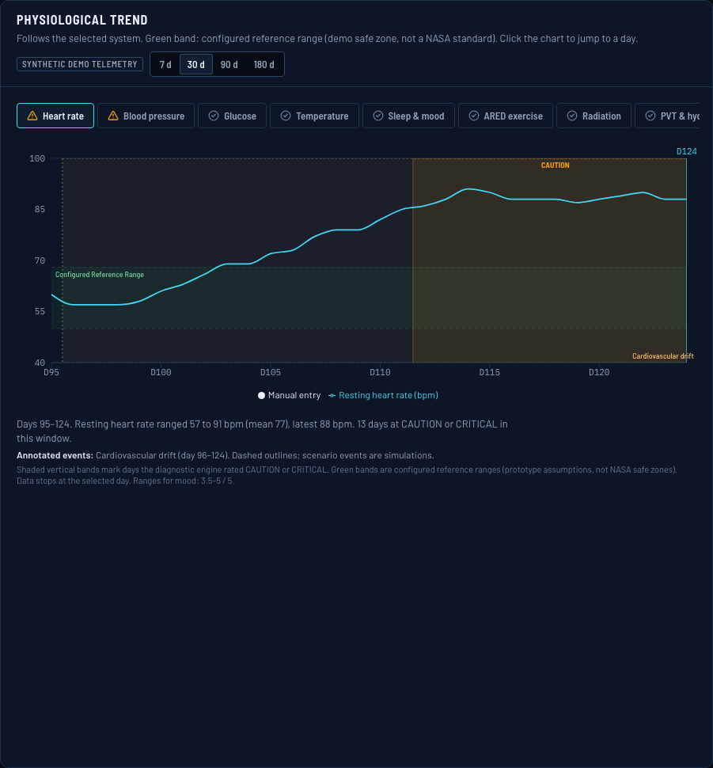 |
| 5 | Trend, radiation, scenario C, with precursor and SEP annotations | 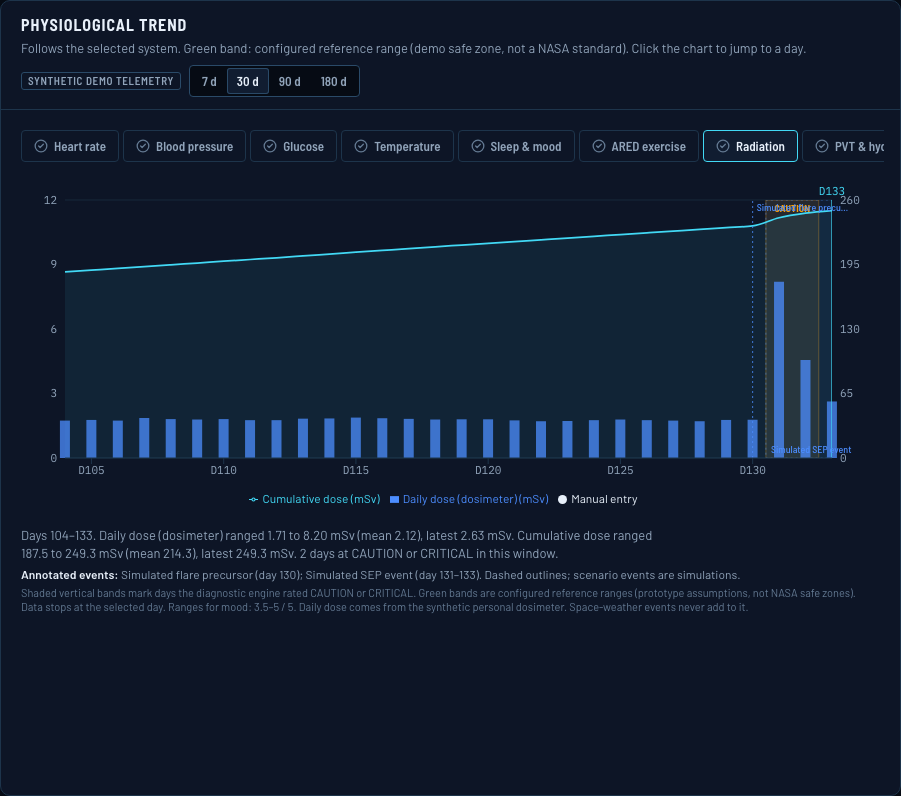 |
| 6 | System panel, musculoskeletal during the SEP (operational link) | 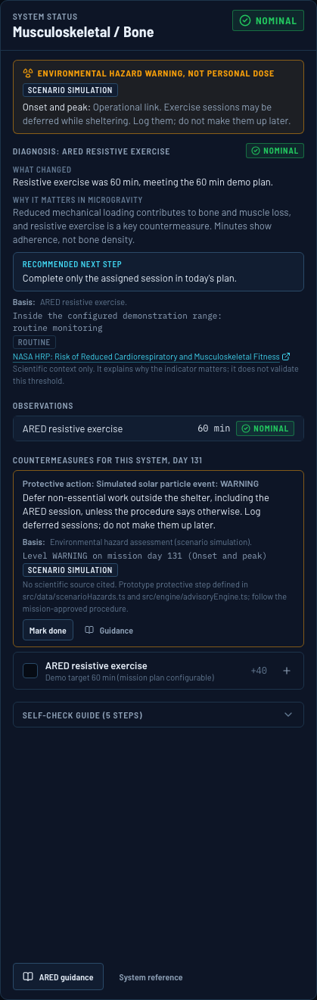 |
| 7 | Countermeasures, XP, streak and follow-ups with basis | 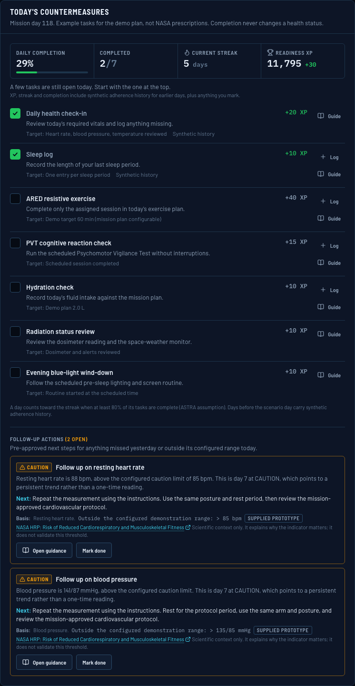 |
| 8 | Alerts and health events | 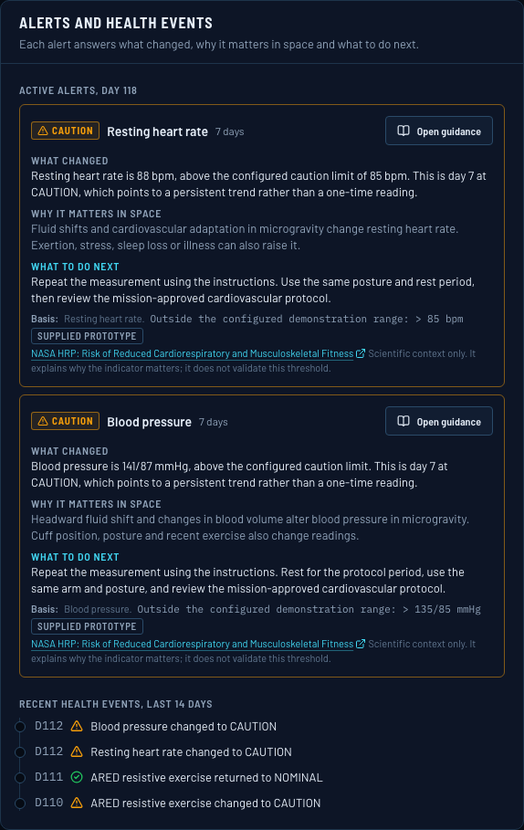 |
| 9 | Space weather: hazard assessment, per-type feed and events | 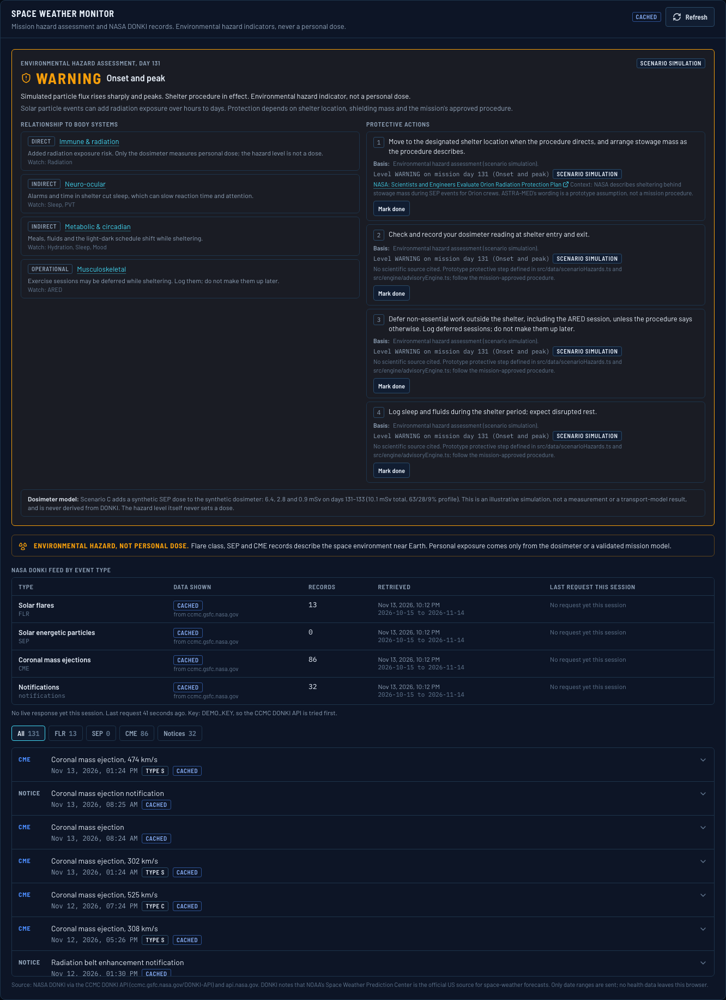 |
| 10 | Guidance drawer (heart rate) | 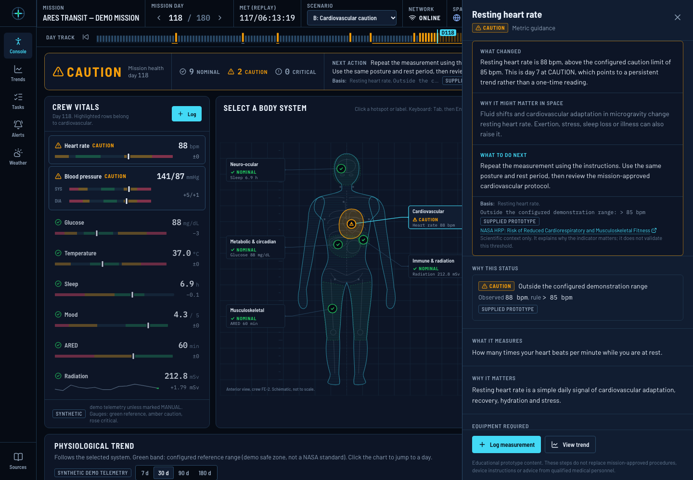 |
| 11 | Log measurement (ship-time entry) | 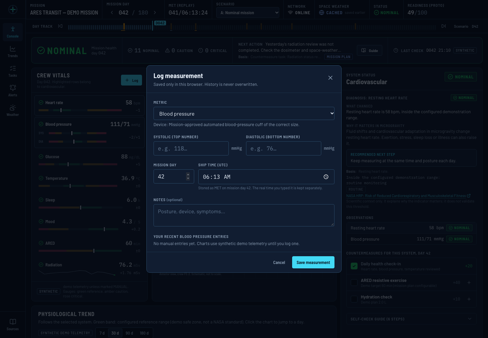 |
| 12 | Data sources | 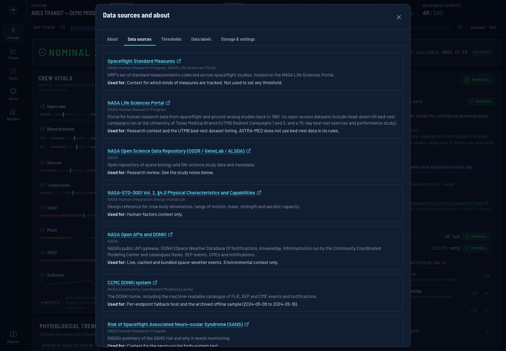 |
| 13 | Thresholds table with provenance | 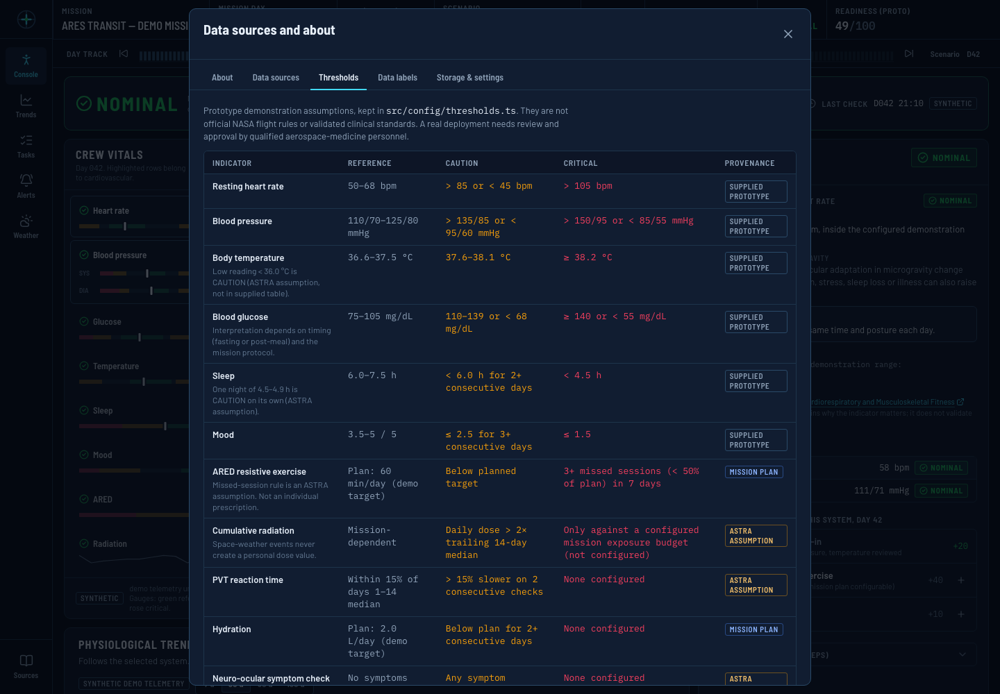 |
| 14 | Mobile console, scenario C (390 px) | 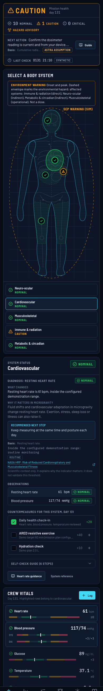 |
| 15 | Mobile guidance sheet | 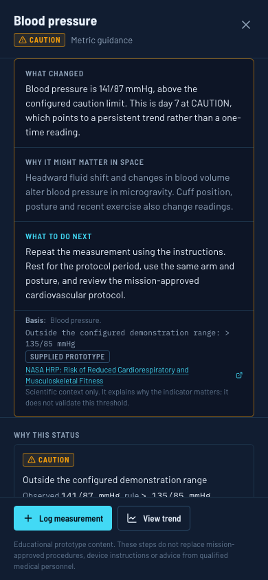 |
| 16 | Tablet console, scenario B (820 px) | 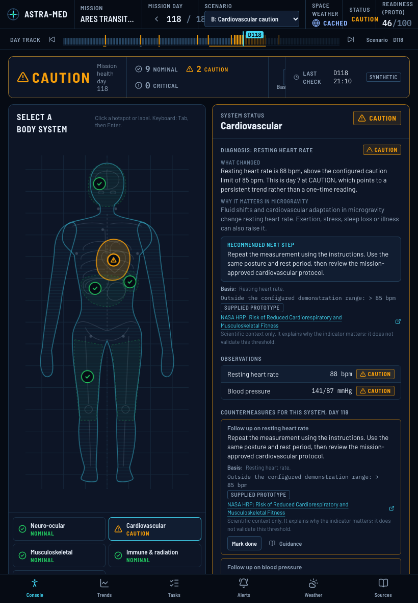 |

Notes on the captures:

- **Screenshot 9** shows CACHED. The screenshot browser had already fetched live data for this origin on an earlier page load, so this load correctly reports "No request yet this session". The LIVE path was verified separately (section 2).
- **Screenshot 11:** headless Chrome did not paint the body plate behind the modal's backdrop. In a normal browser the plate renders with the modal open (verified: SVG 527 × 527 px, 5 hotspots present).

## 6. Remaining limitations

1. **Service worker:** verified in real Chrome (Claude in Chrome, 2026-11-14). The service worker was active with 20 cached assets. With the preview server stopped, a reload still served the full console: body map, trend chart, saved scenario, and space weather labelled CACHED.
2. **api.nasa.gov path:** with DEMO_KEY exhausted (HTTP 429), the api.nasa.gov path was exercised in unit tests and returned live 200s on 2026-11-13, but not in today's live run. A personal key would re-verify it.
3. **Thresholds:** all are prototype assumptions or supplied prototype values. None is scientifically validated, and the context references explain relevance only.
4. **Scenario C:** the dose overlay is illustrative. Real SEP doses depend on event spectrum, shielding and location.
5. **Live DONKI:** describes near-Earth space weather, not the demo spacecraft. The 72-hour SEP awareness window is an assumption.
6. **MET replay:** the top-bar MET combines the selected day with the wall-clock time of day; it is a demo replay, not a mission clock.
7. **Health data:** single demo crew identity. No device integration. `localStorage` is unencrypted and not a medical record store.
8. **Charts:** annotation labels can overlap in short windows when events are close together. The text list under the chart is the accessible fallback.

## 7. Real-Chrome walkthrough (Claude in Chrome, 1200 × 780 window)

| Check | Result |
| --- | --- |
| DONKI on first load | All four types LIVE from the CCMC DONKI API (HTTP 200). FLR 13, SEP 0, CME 86, notifications 32. No app console errors. |
| Scenario switch with the real dropdown | B to C jumped to day 131: CAUTION, hazard WARNING, Immune & Radiation auto-selected, toast with Undo |
| Manual selection during a hazard | Selecting Neuro-ocular keeps your choice. The panel shows "Show priority system" and the hazard banner offers "Show immune & radiation". |
| Guidance drawer, log form, Overview | Open and close correctly. A dosimeter reading lower than the previous day is rejected with a reason. |
| Offline reload | Works from the service worker with the server stopped |

Defects found in Chrome and fixed:

1. At widths below 1536 px the next-action text was squeezed to "Yester…". The status line now wraps the action onto its own row.
2. The system panel stretched into an empty box beside the vitals list. It now sizes to its content.
3. Event annotations showed on unrelated charts, such as the sleep anomaly on the heart-rate chart. Each event now lists its metrics.
4. CME "Type S" was unexplained. It now reads "Speed class S", with the DONKI SCORE scale in the details.
5. Nominal readings that carry a note, such as one short night, were described as "inside the configured range". The basis now quotes the note.
6. Immune & Radiation system guidance ignored the active hazard. It now leads with the protective step and shows the hazard link.
7. The scenario jump button was announced to screen readers only as "D118". It now has a full label.

Not checked in real Chrome: the window would not shrink below desktop width, so mobile layouts were verified in the built-in browser and the CDP screenshots instead.

## 8. Clarity pass (product review, 2026-11-14)

| Review item | Change | Verified |
| --- | --- | --- |
| A. Scenario and day mismatch | Selecting a scenario already jumps to its demo day (A 42, B 118, C 131). Viewing any other day now shows a scenario banner with "Go to day N", including for Scenario A. The track button reads "Demo start D42". | `?scenario=nominal&day=180` shows the banner; switching to B and C lands on days 118 and 131. |
| B. Hierarchy | The console's lead band is now three parts: astronaut health status, the body system to watch (named out-of-range indicators and hazard link) and the next action. Counts, hazard chip and last check are secondary. | Days 118 and 131 at 1280 px and 375 px, no horizontal overflow. |
| C. Readiness | The engine returns the four weighted parts (50 / 20 / 15 / 15). The top-bar score opens a breakdown that labels it an engagement indicator, not a medical clearance. The countermeasures panel explains how the score relates to today's completion. | Day 180: 41.7 + 19.1 + 15 + 15 = 91. New unit test checks weights and sum. |
| D. Space weather | Hazard assessment and protective sequence come first, then the hazard-not-dose note. The per-type feed table, filters and raw DONKI records sit in a collapsed "NASA DONKI event records" section with a one-line summary. | 133 records and 4 type rows inside the section. |
| E. Demo data | A persistent DEMO DATA chip in the top bar (mobile and desktop) opens the Overview, which now starts with "What is simulated and what is real". | Chip visible at 375 px and 1280 px. |

## 9. Onboarding, simplification and NASA foresight (2026-11-14)

| Change | Verified |
| --- | --- |
| First visit opens the Overview. Closing it stores `astra-med:v1:onboarding` and starts an 8-step spotlight tour (Next, Back, Skip, Esc, arrow keys, focus kept in the card). The tour can be replayed from the Overview. Deep links with a hash skip the automatic Overview. | Fresh storage at 1280 px: Overview opened, X started the tour, all 8 steps found their targets, record saved; reload did not reopen it. At 375 px the card docks above the bottom bar with no horizontal overflow. |
| Navigation highlights every section in the reading area, so Tasks and Alerts light up together when side by side. | Scrolled to Countermeasures at 1280 px: Tasks and Alerts both current. |
| Simplified: task rows show title and target on one line with Log and Guide side by side; "Synthetic history" per row removed (the DEMO DATA chip covers it); basis lines collapse behind "Why this step?"; "Why it matters in microgravity" collapses. | Visual check at 1280 px. |
| Trend watch (`src/engine/trendEngine.ts`): a 7-day least-squares projection for NOMINAL indicators that have left their reference band. Shown when the line reaches a caution limit within 7 days with R² ≥ 0.5. Never changes a status. ASTRA assumption. | Scenario B flags heart rate from day 104, eight days before CAUTION on day 112. Nominal day 42 is quiet. Unit tests. |
| Earth and Mars CME forecast from NASA CCMC WSA-ENLIL runs in DONKI (`WSAEnlilSimulations`, CORS open), cached as `astra-med:v1:enlil-cache`, labelled LIVE / CACHED / NOT LOADED. A Mars arrival within 72 h also appears in the status band. | Live fetch from ccmc.gsfc.nasa.gov; parsing, de-duplication and cache sanitising unit-tested. |
| Earth–Mars one-way signal delay from JPL approximate Keplerian elements, shown in the status band and the Overview. | 2025-01-12 gives 0.642 AU (published close approach 0.642 AU); 2027-02-19 gives 0.678 AU. |
